# Vision Models & Feature Encoders

`luna.models` houses the machine learning architecture for detecting lunar collapse pits, skylights, and morphological structures in high-resolution orbital imagery.

---

## 1. Multi-Stage Pipeline Architecture

```mermaid
flowchart LR
    Raw["Raw NAC Sub-Tile 256x256"] --> DINO["DINOv3 ViT-S/16 Backbone"]
    DINO --> Embedding["384-d Matryoshka Vector"]
    Embedding --> Binarize["PolarQuant-Hadamard Transform"]
    Binarize --> PithosIndex["pithosdb SIMD Search"]
    PithosIndex --> Candidate["CandidateHit (Lunar NMS)"]
    Candidate --> Stage2["Stage-2 Decoder & PhysicsValidator"]
    Stage2 --> Output["RefinedHit (Polygon, Depth, Confidence)"]
```



---

## 2. DINOv3 Feature Backbone (`luna.models.dinov3.dino_encoder`)

`luna` employs Vision Transformers (DINOv3 ViT-S/16) pre-trained and fine-tuned with LoRA adapters on lunar terrain:

- **Input**: Standardized $256 \times 256$ float32 reflectance patches (stride 192 px).
- **Output**: 384-dimensional $L_2$-normalized Matryoshka feature representation (`DINO_DIM = 384`).
- **Invariance**: Robust to illumination variation (phase angles from $15^\circ$ to $80^\circ$) and solar incidence.
- **Attention Rollout**: Optional extraction of spatial self-attention maps from the last transformer block.

### Python API Example

```python
import numpy as np
from luna.models.dinov3.dino_encoder import DINOEncoder

# Initialize encoder with local or HuggingFace LoRA adapters
encoder = DINOEncoder(
    lora_dir="luna/lunar-dinov3-lora",
    model_size="vits16",
    matryoshka_dim=384,
)

# Encode a batch of uint8 or float32 image tiles (B, H, W)
tiles = np.random.randint(0, 255, size=(4, 256, 256), dtype=np.uint8)
embeddings = encoder.encode(tiles)
print(f"Embeddings shape: {embeddings.shape}")  # (4, 384)
```

---

## 3. Stage-2 Dense Decoders & Physics Validation

Candidate bounding boxes flagged by the screening engine are forwarded to a Stage-2 dense decoder for pixel-precise segmentation and physics verification:

- **Spatial Token Reconstruction (`GeometricReconstructor`)**: Reshapes flat ViT patch tokens back into 2D spatial feature representations.
- **Feature Pyramid Network (`FeaturePyramidNetwork`)**: Progressively upsamples features with lateral connections to $256 \times 256$ resolution.
- **Three-Class Segmentation (`ThreeClassSegmentationHead`)**:
    1. Background Terrain ($C=0$)
    2. Deep Shadow / Pit Void ($C=1$)
    3. Sunlit Rim Collar ($C=2$)
- **Physics-Based Illumination Validator (`PhysicsValidator`)**:
    - Calculates the shadow vector direction $\theta_{\text{shadow}}$.
    - Validates against the known sub-solar azimuth $\theta_{\text{sun}}$ ($|\Delta\theta| \le 45^\circ$).
    - Estimates depth $d = L_{\text{shadow}} / \tan(\theta_{\text{incidence}})$ to reject shallow impact craters.
    - **Surface Artifact Rejection**: Automatically tags and rejects known non-natural lunar hardware and landing sites (Apollo 11 Tranquillity Base, Apollo 14 Fra Mauro, and TMA-1 coordinate bounds).

