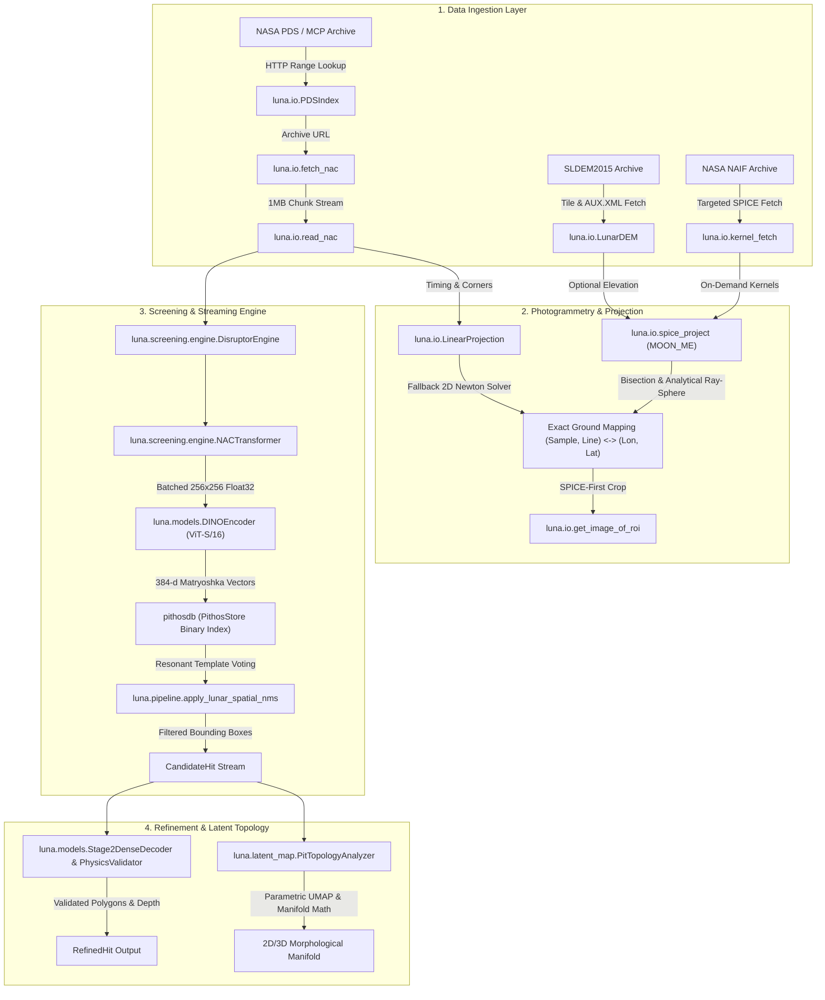

# LUNA

> **L.U.N.A.** - *Lots of Unexplained NAC Anomalies*  
> Python library for lunar pit detection, SPICE photogrammetry, and orbital imagery analysis on NASA LROC NAC products.

---

## Key Features

- **SPICE Photogrammetry (`luna.io.spice_project`)**: Pushbroom camera model in the `MOON_ME` Mean-Earth/Polar-Axis body-fixed frame implementing 1D bisection `ground_to_image` and analytical ray-sphere / iterative DEM `image_to_ground` ray-tracing directly in Python via `spiceypy`.
- **Targeted SPICE Pool Management**: On-demand kernel fetching and loading (`ensure_kernels_for_date`, `furnish_kernels_for_date`) with structured `MissingKernelError` handling to prevent CSPICE DAF-handle table exhaustion across multi-year missions.
- **Optional Topography & Elevation Correction (`luna.io.dem`)**: Parallax compensation using explicit `alt_m` or automated SLDEM2015 tile lookups via `LunarDEM` (`fetch_dem_for_region`, `default_dem`) with GDAL `.aux.xml` vertical scale validation.
- **SPICE-First ROI Extraction & Orbit Support (`luna.io.projection`)**: `get_image_of_roi` prioritizes exact SPICE projection before falling back to `LinearProjection` with automatic ascending/descending flight-direction detection.
- **Vision Models (`luna.models`)**: Feature extraction with DINOv3 Vision Transformers, Stage-2 decoders, and boundary refiners.
- **Screening Pipeline (`luna.screening`)**: Disruptor ring-buffer paired with native C++ `Pithos` binary embedding search for candidate retrieval.
- **Latent Manifold Analysis (`luna.latent_map`)**: UMAP projections, metric estimations, and topology inspection of lunar terrain.
- **PDS Resolution (`luna.io.pds_index`)**: Binary search index lookup over NASA MCP PDS4 mirrors and dynamic JPL volume directories via HTTP range requests with CSV-first geometry parsing.

---

## Architecture Overview



---

## Quick Example

```python
from luna.io.dem import LunarDEM, fetch_dem_for_region
from luna.io.pds_fetch import fetch_nac
from luna.io.spice_project import ground_to_image, image_to_ground

# 1. Fetch NAC product on-demand from PDS
img_path = fetch_nac("M1118880788RC", dest_dir="data/_scratch")

# 2. Project lunar ground coordinates (lon, lat, optional elevation/DEM) to pixel coordinates
# Example: Marius Hills Skylight (alt = -2010 m relative to 1737.4 km lunar sphere)
sample_px, line_px = ground_to_image(
    img_path,
    lon_deg=303.228,
    lat_deg=14.091,
    alt_m=-2010.0,
)

# Or use automated SLDEM2015 terrain lookup via LunarDEM:
tiles = fetch_dem_for_region(min_lat=13.5, max_lat=14.5, min_lon=302.5, max_lon=304.0)
with LunarDEM(tiles) as dem:
    sample_px, line_px = ground_to_image(img_path, lon_deg=303.228, lat_deg=14.091, dem=dem)
    lon_deg, lat_deg = image_to_ground(img_path, sample=sample_px, line=line_px, dem=dem)

print(f"Target pixel coordinate: Sample = {sample_px:.2f}, Line = {line_px:.2f}")
```

---

## Documentation Roadmap

- [**Installation Guide**](getting-started/installation.md): Set up virtual environment, GPU dependencies, and SPICE kernels.
- [**SPICE & Photogrammetry Guide**](guide/spice-and-photogrammetry.md): Deep dive into CSPICE kernel pool limits, pushbroom camera geometry, topography parallax, and ascending orbit math.
- [**Vision & Models Guide**](guide/vision-and-models.md): DINOv3 feature backbones and Stage-2 decoders.
- [**Screening & Streaming Guide**](guide/screening-and-pithos.md): Multi-scale binary indexing and ring-buffer streaming.
- [**API Reference**](reference/io.md): Comprehensive module and class documentation.

---

## Research Group & Maintainers

`luna` is developed and maintained by the **[Moonatics](https://github.com/moonatics)** research group:

- [`@F1nnSBK`](https://github.com/F1nnSBK)
- [`@schutera`](https://github.com/schutera)
